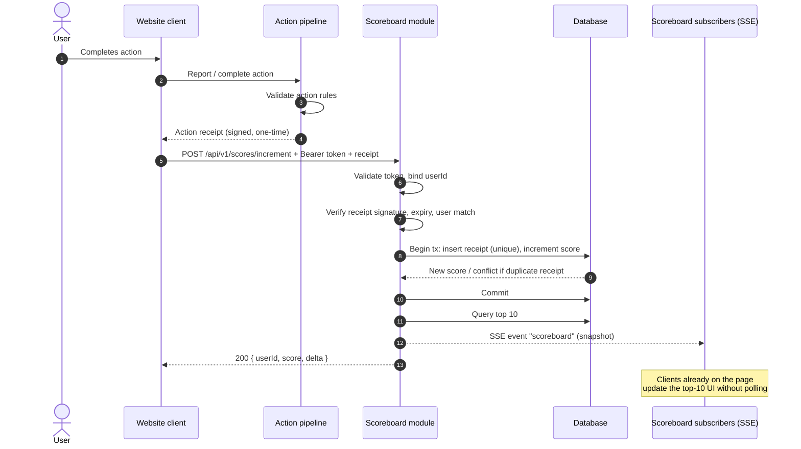
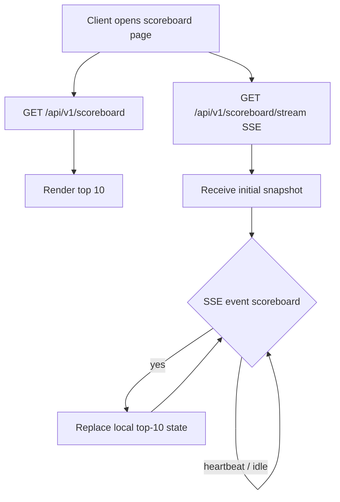
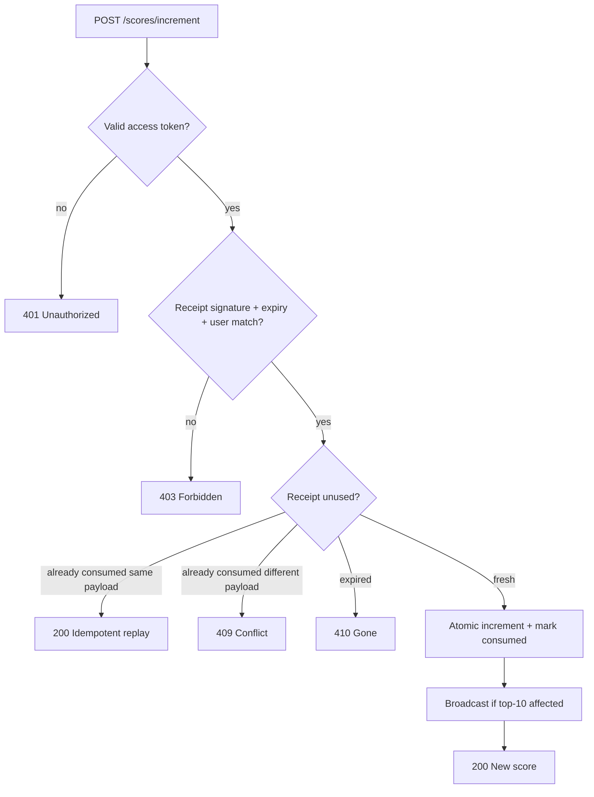

# Problem 5 — Live Scoreboard API Module

Specification for a backend module that maintains a live top-10 scoreboard and accepts authorized score updates when a user completes an action. Intended for a backend engineering team to implement on the API service.

## Goals

| Requirement | Module responsibility |
| --- | --- |
| Top-10 scoreboard on the website | Serve a ranked list of the highest scores (limit 10) |
| Live updates | Push scoreboard changes to connected clients without polling |
| Action completion raises score | Accept a score-increment request after an action completes |
| API call from the client / action pipeline | Expose a dedicated score-update endpoint |
| Block unauthorized score increases | Authenticate the caller and authorize the increment before mutating state |

Out of scope for this module: defining what the user action is, rendering the website UI, and user registration / login product flows (this module consumes auth tokens issued by the existing identity system).

## Assumptions

These defaults keep the first implementation small and reviewable. Call them out in tickets if product choice differs.

1. **Identity** — The API service already issues short-lived access tokens (JWT or opaque session tokens). Score updates require a valid token for the user whose score is being increased.
2. **Score model** — Each user has one integer `score` (non-negative). Completing an action adds a positive delta defined by the server (or by a signed action receipt), never by an arbitrary client-supplied total.
3. **Action proof** — The client must not be trusted to invent score deltas. The preferred path is: action service (or game engine) issues a one-time **action receipt**; the scoreboard module verifies and consumes it. If no separate action service exists yet, the module may accept an `actionType` that maps to a server-side delta table, still under authenticated rate limits.
4. **Live channel** — Use **Server-Sent Events (SSE)** for scoreboard fan-out (unidirectional, simple, HTTP-friendly). WebSockets are an acceptable alternative if the platform already standardizes on them.
5. **Consistency** — Score increments are atomic. Concurrent increments for the same user must not lose updates. Ranking ties are broken by `updatedAt` ascending (earlier update ranks higher), then by `userId` ascending.
6. **Public read** — The top-10 scoreboard is public (no auth required to read or subscribe). Write paths require auth.

---

## Architecture

```
┌─────────────┐     action complete      ┌──────────────────┐
│  Website /  │ ───────────────────────► │ Action pipeline  │
│  Client app │                          │ (game / feature) │
└──────┬──────┘                          └────────┬─────────┘
       │                                          │
       │  subscribe (SSE)                         │ action receipt
       │  GET /scoreboard                         │ (signed / one-time)
       ▼                                          ▼
┌─────────────────────────────────────────────────────────────┐
│                    API service — Scoreboard module          │
│  Auth middleware · Score service · Rank query · Broadcaster │
└────────────────────────────┬────────────────────────────────┘
                             │
                             ▼
                       ┌──────────┐
                       │ Database │
                       │ (scores) │
                       └──────────┘
```

**Components**

| Component | Role |
| --- | --- |
| Auth middleware | Validates access token; binds request to `userId` |
| Score service | Verifies action receipt / maps action type → delta; applies increment transactionally; returns new score |
| Rank query | Returns top 10 from DB or a maintained rank structure |
| Broadcaster | After a successful increment that changes the published top 10 (or any top-10 member’s score), writes a scoreboard snapshot to open SSE connections on this server |

---

## Data model

### `users_scores`

| Column | Type | Notes |
| --- | --- | --- |
| user_id | UUID / string PK | Same id as identity system |
| display_name | string | Shown on scoreboard; sanitized at write time |
| score | bigint / integer | `>= 0` |
| updated_at | timestamptz | Last successful increment |
| created_at | timestamptz | First score row |

Indexes:

- `(score DESC, updated_at ASC, user_id ASC)` for top-10 queries
- Unique on `user_id`

### `action_receipts` (recommended)

| Column | Type | Notes |
| --- | --- | --- |
| receipt_id | UUID PK | Idempotency key |
| user_id | UUID | Must match authenticated user |
| action_type | string | Opaque to this module beyond delta lookup |
| delta | integer | Positive; copied from signing payload or action catalog |
| expires_at | timestamptz | Reject after expiry |
| consumed_at | timestamptz nullable | Set once when applied; second use → conflict |
| signature / hmac | string | Verified against shared secret or public key of action pipeline |

---

## HTTP API

Base path: `/api/v1/scoreboard`

### `GET /api/v1/scoreboard`

Returns the current top 10.

**Auth:** optional / public  
**Response `200`:**

```json
{
  "generatedAt": "2026-10-20T03:00:00.000Z",
  "entries": [
    {
      "rank": 1,
      "userId": "u_123",
      "displayName": "Ada",
      "score": 1200
    }
  ]
}
```

Always returns at most 10 entries. Fewer if fewer users have scores.

### `GET /api/v1/scoreboard/stream`

SSE stream of scoreboard snapshots.

**Auth:** optional / public  
**Headers:** `Content-Type: text/event-stream`, `Cache-Control: no-cache`, keep-alive as appropriate.

Event name: `scoreboard`  
Data: same JSON shape as `GET /api/v1/scoreboard`.

Behavior:

1. On connect, send one snapshot immediately.
2. On each relevant score change, send a new snapshot.
3. Optionally send `: heartbeat` comments every 15–30s to keep proxies from closing the connection.
4. Clients reconnect with standard SSE retry; server may include `id:` / `Last-Event-ID` later (see Improvements).

### `POST /api/v1/scores/increment`

Increments the authenticated user’s score after a completed action.

**Auth:** required (`Authorization: Bearer <access_token>`)  
**Body (preferred — receipt-based):**

```json
{
  "receiptId": "550e8400-e29b-41d4-a716-446655440000",
  "actionType": "daily_challenge",
  "issuedAt": "2026-10-20T02:59:50.000Z",
  "expiresAt": "2026-10-20T03:04:50.000Z",
  "delta": 10,
  "signature": "<hmac-or-jwt>"
}
```

**Body (fallback — catalog-based, only if no action service yet):**

```json
{
  "actionType": "daily_challenge",
  "idempotencyKey": "client-or-action-uuid"
}
```

In the fallback, `delta` is looked up server-side from an `actionType → delta` table. The client must not send a free-form score or absolute total.

**Responses**

| Status | Meaning |
| --- | --- |
| 200 | Increment applied (or idempotent replay of the same receipt / key) |
| 400 | Malformed body, unknown `actionType`, non-positive delta |
| 401 | Missing / invalid token |
| 403 | Token user ≠ receipt user, or signature invalid |
| 409 | Receipt / idempotency key already consumed with a different payload |
| 410 | Receipt expired |
| 429 | Rate limit exceeded |

**Success body:**

```json
{
  "userId": "u_123",
  "score": 1210,
  "delta": 10,
  "receiptId": "550e8400-e29b-41d4-a716-446655440000"
}
```

Errors: `{ "error": { "code": "RECEIPT_EXPIRED", "message": "..." } }`

### (Optional) `GET /api/v1/scores/me`

Returns the caller’s current score and rank (useful for UI chrome). Auth required.

---

## Authorization and anti-abuse

Malicious clients must not be able to invent score gains. Enforce all of the following:

1. **Authenticate** — Reject unauthenticated increment requests.
2. **Authorize subject** — Score may only increase for `token.sub` (or equivalent). Never accept a client-supplied `userId` for the target of an increment.
3. **Server-owned delta** — Prefer signed action receipts (HMAC with a secret known only to the action pipeline and this module, or asymmetric signature). Verify signature, expiry, `userId`, and `actionType` before apply. Fallback: map `actionType` → fixed delta; ignore any client `delta`.
4. **Idempotency** — Store `receiptId` / `idempotencyKey` as consumed. Retries with the same key return the original result; conflicting payloads → 409.
5. **One-time use** — Consumed receipts cannot raise the score again.
6. **Rate limits** — Per-user and per-IP limits on `POST /scores/increment` (e.g. token bucket). Soft limits even with valid receipts reduce blast radius if a signing key leaks.
7. **Transport** — HTTPS only in production. Do not log raw tokens or signatures.
8. **Input hygiene** — Cap body size; allowlist `actionType` values; reject unexpected fields if using a strict schema.

---

## Execution flow

### Happy path — action completes and scoreboard updates live



### Read / subscribe path



### Reject unauthorized increment



---

## Implementation notes for the backend team

### Score increment (pseudocode)

```text
authenticate(request) → userId
parse + validate body
verifyReceipt(receipt, expectedUserId=userId)  // or resolveDelta(actionType)
within transaction:
  try insert receipt_id (unique)
  if duplicate:
    return prior result if payload matches else 409
  update users_scores set score = score + delta, updated_at = now()
    where user_id = userId
  (upsert row if first score)
commit
snapshot = queryTop10()
if snapshotChanged(previousPublished, snapshot):
  broadcaster.publish(snapshot)
return { userId, score, delta, receiptId }
```

### Broadcasting

- Keep an in-memory set of open SSE connections on the API server.
- After a successful increment, write a full top-10 snapshot to those connections. A full snapshot keeps clients simple; the payload is small.
- Send the snapshot when the published top-10 set or any displayed score changes. Sending on every increment is also acceptable.

### Observability

- Metrics: increment latency, increment success/failure by error code, SSE connected clients, broadcast lag.
- Structured logs with `userId`, `receiptId`, `actionType`, `delta` (never tokens/signatures).
- Alert on spike of 403/429 on increment (possible abuse or key misuse).

---

## Configuration

| Variable | Example | Purpose |
| --- | --- | --- |
| `SCOREBOARD_TOP_N` | `10` | Rank list size (fixed at 10 for this product) |
| `ACTION_RECEIPT_HMAC_SECRET` | secret | Verify receipt signatures |
| `ACTION_RECEIPT_MAX_AGE_SECONDS` | `300` | Upper bound even if `expiresAt` is longer |
| `SCORE_INCREMENT_RATE_LIMIT` | `60/min/user` | Abuse throttle |
| `SSE_HEARTBEAT_SECONDS` | `20` | Keep-alive interval |

---

## Test plan (acceptance)

- [ ] `GET /scoreboard` returns at most 10 entries, ordered by score desc with documented tie-breakers.
- [ ] Two concurrent increments for the same user both apply (final score = sum of deltas).
- [ ] Replay of the same `receiptId` does not double-count; returns the same score.
- [ ] Invalid / missing / mismatched-user / expired / bad-signature receipts are rejected with the correct status.
- [ ] Request with a client-chosen `userId` or free-form absolute score cannot raise another user’s score.
- [ ] SSE subscriber receives an updated snapshot after a successful increment that changes the top 10.
- [ ] Unauthenticated user can read and subscribe; cannot increment.

---

## Comments for improvement

Suggestions beyond the minimum viable module. Implement when product or scale requires them.

1. **Action pipeline as source of truth** — Strongest anti-cheat: only the action service mints receipts after server-side validation of the action. The website never decides the delta. Move to this model before public launch if scores have real value (rewards, rankings with prizes).
2. **WebSocket vs SSE** — SSE is enough for scoreboard push. Prefer WebSocket only if you already need bidirectional realtime elsewhere, to avoid two realtime stacks.
3. **Rank materialization** — For large user bases, maintain a Redis sorted set (`ZINCRBY` / `ZREVRANGE 0 9`) updated in the same logical unit as the DB write, or use change-data-capture. Pure SQL `ORDER BY score DESC LIMIT 10` is fine until write volume justifies cache.
4. **Partial broadcasts** — Later, send diffs (`userId`, `newScore`, `newRank`) instead of full snapshots if payload or CPU becomes an issue. Keep snapshot-on-connect.
5. **Event ids / resume** — Add SSE `id` and honor `Last-Event-ID` so reconnecting clients do not miss a burst of updates (or always resend a fresh snapshot on reconnect — simpler and usually enough for N=10).
6. **Cheating beyond HTTP** — Rate limits and receipts stop trivial API spam. They do not stop compromised clients that complete actions “legitimately” via automation. Pair with action-side bot detection, device attestation, or anomaly scoring if that threat matters.
7. **PII / moderation** — `displayName` should be moderated or constrained; consider showing a public handle separate from legal name.
8. **Admin / moderation APIs** — Score correction, ban-from-board, and audit log are useful once the board is competitive; omit from v1 unless support needs them day one.
9. **Contract tests** — Publish an OpenAPI document for the three endpoints and generate client stubs for the website team so live-update payload shape stays stable.

---

## Deliverables checklist (this specification)

| Item | Location |
| --- | --- |
| Module documentation | This `README.md` |
| Execution-flow diagrams | Mermaid sections above |
| Improvement comments | Section “Comments for improvement” |
| Implementable contracts | Data model, HTTP API, auth rules, test plan |
